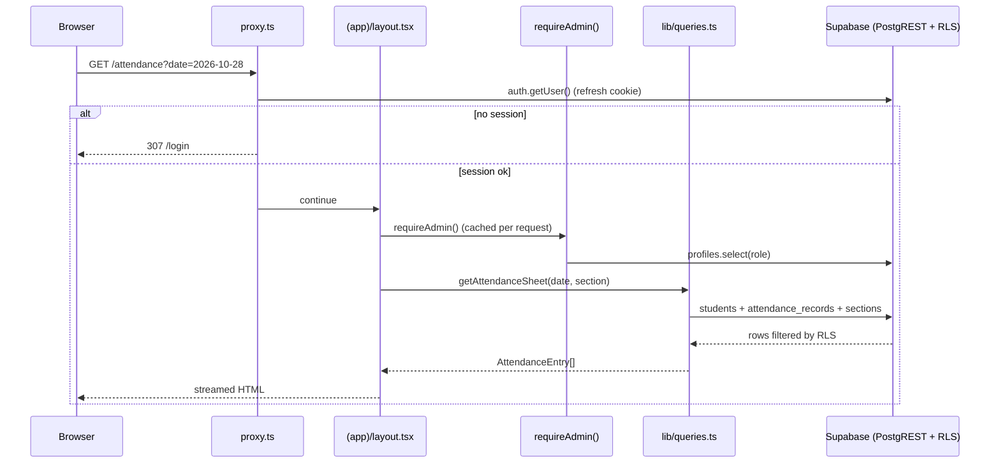
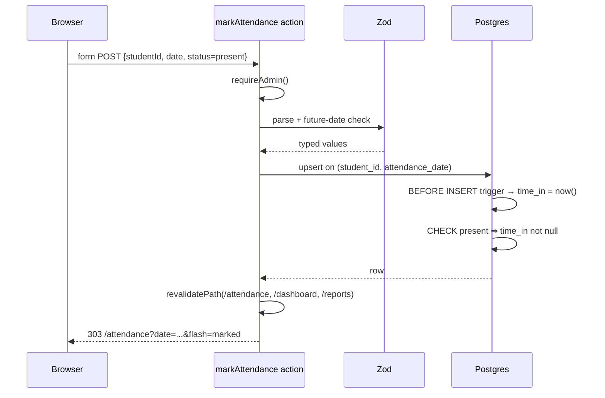

# Architecture

## 1. Runtime topology

```
Browser (React 19)
   │  HTML/RSC + Server Action POSTs
   ▼
Next.js 16 server (Node)
   ├── proxy.ts ............ refreshes Supabase session cookie, optimistic redirect
   ├── Server Components ... read data through lib/queries.ts
   └── Server Actions ...... validate with Zod, write through supabase-js
   │  HTTPS (localhost)
   ▼
Supabase local stack (Docker containers)
   ├── Kong / API gateway ... :54321
   ├── GoTrue (Auth) ........ signs JWTs, stores users
   ├── PostgREST ............ translates supabase-js queries into SQL
   ├── Postgres 17 .......... tables, constraints, triggers, RLS  :54322
   └── Studio ............... :54323 (instructor-friendly table view)
```

`supabase start` creates the containers. No app container is needed: the Next
process runs on the host and talks to the stack over HTTP.

## 2. Next.js directories and why they exist

| Path | Responsibility |
| --- | --- |
| `app/layout.tsx` | Root HTML shell, fonts, metadata. No data access. |
| `app/(app)/layout.tsx` | Protected shell. Calls `requireAdmin()` once, renders nav + sign-out. |
| `app/(app)/*/page.tsx` | One screen each; Server Components fetch through `lib/queries.ts`. |
| `app/login/page.tsx` | Public route; redirects signed-in admins to the dashboard. |
| `app/setup/page.tsx` | Public setup instructions when `.env.local` is missing. |
| `actions/*.ts` | `"use server"` mutation boundary: auth check → Zod → DB → `revalidatePath`. |
| `components/*` | Presentation. Only forms, delete confirmation, and nav need `"use client"`. |
| `lib/queries.ts` | Deep read module: every page asks for a shape, not a query. |
| `lib/validation.ts` | Single source of truth for field rules, reused by every action. |
| `lib/supabase/server.ts` | Cookie-bound client. The only place DB credentials are read. |
| `proxy.ts` | Session refresh + unsigned redirect. Never trusted for authorization. |

## 3. Request flow — rendering a protected page



## 4. Request flow — marking a student present



Two independent guards make the write safe: the action validates shape and
authorization, and the database validates invariants (unique day, status/time
consistency, RLS).

## 5. Data access pattern

Pages never build SQL. They call a small number of intention-revealing functions:

```ts
getDashboardStats(date)          // counts for one day
getAttendanceSheet(date, section) // students + their record (or null)
listStudents(search, sectionId)   // roster with section names
getReport(start, end, section)    // per-student totals + rate
```

Each function hides the join/merge (Supabase returns flat rows; the module maps
`section_id` to a name and `student_id` to a record). This is the "deep module"
discipline from `codebase-design`: a narrow interface over non-trivial logic,
testable without rendering UI.

## 6. Security boundaries

| Boundary | Control |
| --- | --- |
| Anonymous → app | Proxy redirect; RLS denies all `anon` reads anyway. |
| Signed-in non-admin → data | `requireAdmin()` + RLS `is_admin()` (two layers). |
| Browser → database | Only the anon key is public; RLS decides every row. |
| Browser → timestamp | `time_in` is written by a trigger, never accepted from a form. |
| Service role | Used only by `scripts/create-admin.mjs` on the developer machine. |
| Error messages | Login returns a generic "Invalid email or password" to avoid account enumeration. |

## 7. Time zone

The school is in `Asia/Manila`. `lib/format.ts` centralises:
`todayISO()` (what "today" means), `formatTime()` (check-in clock), and
`formatDate()` (DATE columns, rendered in UTC to avoid a day shift).

The database stores `timestamptz`; the browser never computes the timestamp.

## 8. Rendering mode

Cache Components are disabled (`next.config.ts`). Every screen is session-scoped
and reads live data, so request-time rendering is the correct model and avoids
"cached page shows another admin's data" failure modes. See ADR 0002.

`requireAdmin()` is wrapped in React `cache()` so the layout and page share one
auth round trip per request.

## 9. Known limits / extension points

- No automated tests yet (ticket T9).
- Single admin role; adding teachers means: a `teacher` role, section ownership,
  and narrower RLS policies (`section_id = any(...)`).
- Attendance notes exist in the schema but have no UI field yet.
- Realtime is not used; `lib/supabase/client.ts` is the hook for it.
