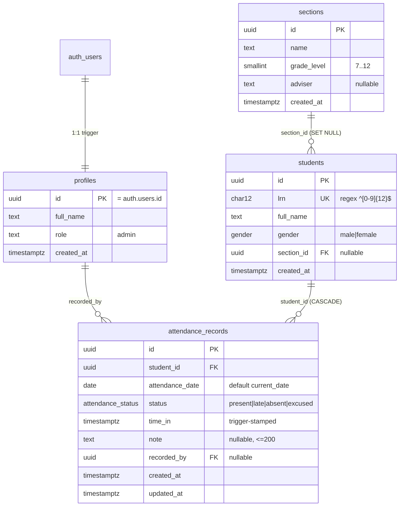

# ERD & database notes



## Constraints that matter in the defense

| Constraint | Why it exists |
| --- | --- |
| `students.lrn UNIQUE` + `CHECK (lrn ~ '^[0-9]{12}$')` | One learner, one LRN; blocks typos even if the client is bypassed. |
| `sections_name_grade_unique (name, grade_level)` | "Rizal" can exist in Grade 7 and Grade 8, but not twice in Grade 7. |
| `attendance_one_per_day (student_id, attendance_date)` | Makes the upsert (`onConflict`) idempotent — clicking Present twice never duplicates a day. |
| `attendance_time_required` | Present/late must carry a timestamp; absent/excused must not. |
| `stamp_attendance_time` trigger | The clock is a database fact, not a browser value. Also clears `time_in` when status becomes absent/excused. |
| `set_updated_at` trigger | Audit trail on edits. |
| FK `ON DELETE CASCADE` (attendance) | Removing a student removes their history deliberately. |
| FK `ON DELETE SET NULL` (section) | Removing a class never deletes learners. |

## Row Level Security

All four tables have RLS enabled. There are no `anon` policies at all, so the
public API key alone returns nothing.

| Table | Policy | Rule |
| --- | --- | --- |
| `profiles` | `admins read own profile` | `id = auth.uid()` (SELECT only) |
| `sections` | `admins manage sections` | `is_admin()` for all commands |
| `students` | `admins manage students` | `is_admin()` for all commands |
| `attendance_records` | `admins manage attendance` | `is_admin()` for all commands |

```sql
create function public.is_admin() returns boolean
language sql stable security definer set search_path = public as $$
  select exists (
    select 1 from public.profiles
    where id = auth.uid() and role = 'admin'
  );
$$;
```

`security definer` is required: the profile lookup must not be filtered by the
caller's own RLS policy (which only allows reading their own row). The
`set search_path` prevents function-hijacking via a malicious schema.

## Reporting view

`attendance_daily_summary` (a view with `security_invoker = true`) aggregates
present/late/absent/excused per date and section. `security_invoker` means the
view runs with the caller's permissions — RLS still applies.

## Indexes

- `attendance_date_idx` — the daily sheet and reports filter by date.
- `attendance_student_idx` — per-student history and FK lookups.
- `students_section_idx` — section filter and roster counts.
- `students_name_idx` — name search (`ilike`).

## How to show it live

1. `npx supabase start`, then open Studio at <http://127.0.0.1:54323>.
2. Database → Tables → `attendance_records` → show the unique constraint and the
   `time_in` value from a check-in.
3. Authentication → Users → confirm only the admin exists and sign-up is off.
4. SQL editor (as `postgres`, bypasses RLS): `select * from pg_policies;` then
   explain that the browser uses the `authenticated` role instead.
